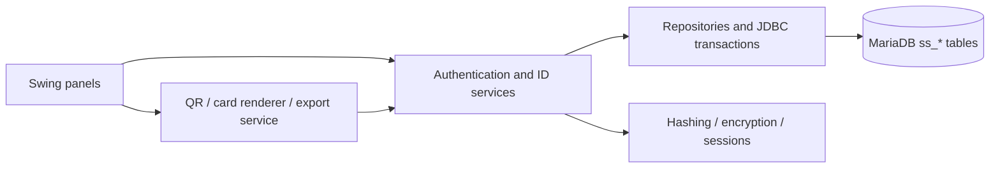
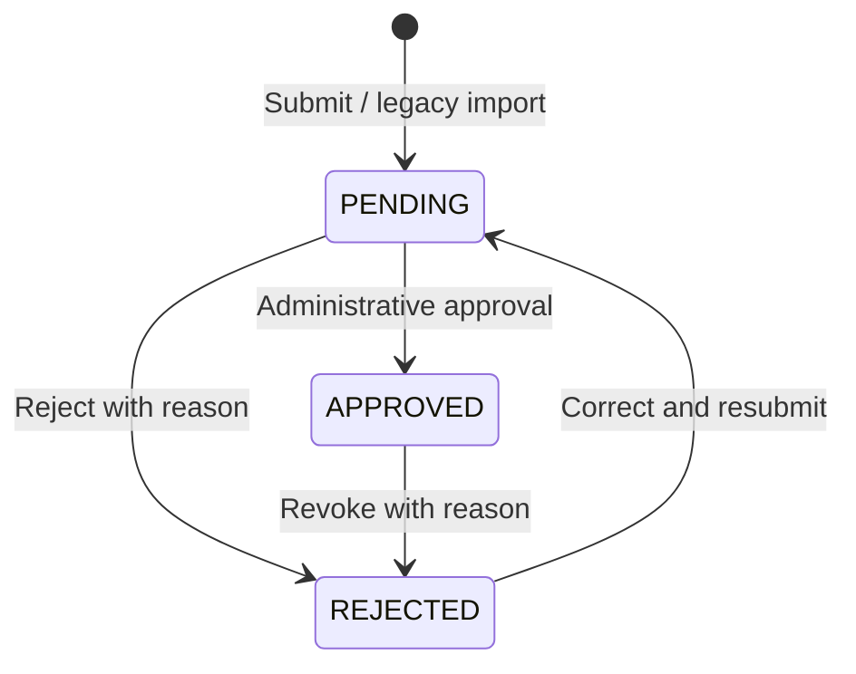

# SoftSecure ID Generator

A Java 17 / Swing desktop application for student and faculty identity cards.
SoftSecure manages authenticated account access, identity submissions,
administrative decisions, QR verification, printing and protected PDF export.

**Validation status:** this refactor was performed through static source review
only. The application has **not been compiled, built, launched or automatically
tested**, and no database was contacted or migrated. The source implements the
controls described below; runtime correctness, layout, database compatibility,
printer output and cryptographic interoperability still require validation.
See [the review record](docs/STATIC_REVIEW.md).

This is a production-oriented foundation for **trusted institutional
workstations**, not a certified production deployment. Because the application
connects directly to MariaDB, anyone controlling the workstation can potentially
extract its database credentials and encryption keys. Deploy a server-side
authorization boundary before distributing it to untrusted devices.

## Features and modules

- One sign-in flow with database-assigned administrator, student and faculty roles.
- Persistent account lockout, inactivity/absolute session limits, password changes
  and operator account recovery.
- Student/faculty forms retaining identifier, name, study mode/department, gender,
  blood group, address, phone, parent/emergency number, email, birth/issue dates and portrait.
- Pending requests, approval, rejection with reasons, corrections, resubmission,
  revocation and audit events. A second administrator approves admin-submitted requests.
- Paginated administration queue and approved student lookup; faculty lookup is
  available only when explicitly enabled by configuration.
- Shared card preview with accessible text details, printing, PNG export and
  AES-256 protected PDF export for both member types.
- QR codes with opaque random references; authenticated online verification
  checks the current approved state. Codes contain no name, phone or address.
- Explicit legacy import using the original CBC key/IV and a supplied charset;
  original tables remain untouched.

**Not implemented:** OTP/MFA, SMS/email delivery, public web verification,
camera scanning, digitally signed PDFs, offline signature verification,
automatic key rotation, automatic card expiration, remote administration,
self-registration or a server API. The old SMS class was an isolated demo,
not an authentication/OTP feature.

## Technology and architecture

| Area | Implementation |
| --- | --- |
| Runtime/UI | Java 17, `javax.swing`, Nimbus, layout managers, `SwingWorker` |
| Persistence | JDBC, MariaDB Connector/J 3.5.11, InnoDB transactions |
| QR | ZXing core and javase 3.5.3 |
| PDF | Apache PDFBox 3.0.8 |
| Cryptography | JDK PBKDF2-HMAC-SHA256, AES-256-GCM, HMAC-SHA256, `SecureRandom` |
| Build | Maven; optional Ant bridge using the same POM |
| Logging | `java.util.logging` with sanitized event references |

The Maven migration removes broken developer-machine JAR references, duplicate
QR libraries and dependency JARs from application resources. PDFBox replaces
iText; JCalendar, QRGen, commons-io and the original Bouncy Castle JARs are no
longer direct dependencies. Java 17 and Swing are retained.



UI classes do not contain SQL or encryption. Services enforce role, ownership,
session and workflow checks. Repositories bind query values and close JDBC
resources. Record/profile encoding is explicit and versioned; it does not use
Java object deserialization. `AppServices` constructs dependencies directly.

## Application workflow

1. An operator creates an administrator using the terminal maintenance utility.
2. The administrator provisions a student/faculty account and securely shares its
   initial credentials. The member can change their password after signing in.
3. The member submits their own details, or an administrator submits on behalf
   of an existing member. Submission creates a **PENDING** request, not a valid card.
4. An administrator opens the request and checks its complete details and portrait.
   Approval creates a QR reference; rejection records a reason.
5. A rejected request can be corrected and resubmitted. An approved card must
   first be revoked before its details can be changed. Reapproval issues a new QR reference.
6. The member or an administrator exports the approved card as PNG or protected
   PDF, or prints it. Every export rechecks approval and access in the database.
7. A signed-in user verifies QR text or a QR image. The result returns only the
   approved member name, identifier and role, to compare with the holder.



One current request exists per member. Audit records preserve action references,
not every historical profile revision. Exported files are snapshots: revocation
invalidates online verification but cannot erase an already printed/downloaded card.

## Directory structure

```text
config/application.example.properties    Safe configuration template
database/schema.sql                     Additive MariaDB schema
docs/PROJECT_REVIEW.md                   Original source/dependency/flow inventory
docs/MIGRATION.md                        Compatibility and recovery procedure
docs/SECURITY.md                         Implemented controls and trust limits
docs/STATIC_REVIEW.md                    Static review and deferred validation
docs/screenshots/README.md               Screenshot placeholders
src/main/java/com/softsecure/id/
    Application.java                    Swing entry point
    AppServices.java                    Dependency composition
    config/                             Configuration loading
    domain/                             Role, status, profiles, request records
    security/                           Passwords, authenticated encryption, sessions
    persistence/                        JDBC, repositories, profile codec
    service/                            Workflow, authorization, validation
    export/                             Image input, QR, card rendering, PDF/PNG
    ui/                                 Unified window and feature panels
    maintenance/                        Operator provisioning/recovery/legacy import
pom.xml                                 Canonical build and dependency manifest
build.xml                               Optional Ant-to-Maven bridge
```

Old local `src/Files`, `build`, `dist`, `aes_key.bin` and `aes_iv.bin` artifacts
are ignored and are **not included by Maven**. They were retained on disk for
recovery; they are not part of the distributable source. In particular, never
run the old `dist/JavaApplication.jar` as the new application.

## Prerequisites

- JDK 17 and Maven 3.9+ on `PATH`; a graphical desktop for Swing.
- MariaDB with InnoDB, `utf8mb4`, JDBC connectivity and an institution-managed
  database account. MariaDB 10.11+ is the intended deployment baseline; no server
  version was exercised in this refactor.
- A configured TLS trust chain for remote database access.
- A real terminal for the maintenance utility (`System.console()` is required).
- Optional configured printer; sufficient permissions to a private export folder.

## Database setup

The repository did not contain a database dump. Existing table names/columns were
inferred from original SQL and cannot establish the actual installed schema.
Take a verified backup of the database, keys, IV and original portrait files first.

1. Have a database administrator create an empty `idcardgen` database (or select
   the existing one), using `utf8mb4`. Apply `database/schema.sql` through your
   normal MariaDB administration tool. It creates only `ss_users`, `ss_requests`
   and `ss_audit`; it does not modify `LOGIN`, `student` or `faculty`.
2. Provision a dedicated account restricted to the required host/network.
   Normal operations need `SELECT`, `INSERT`, `UPDATE` on `ss_users` and
   `ss_requests`, and `INSERT` on `ss_audit`. Do not grant application access to
   `DROP`, `ALTER`, `GRANT`, `FILE` or `DELETE`.
3. Use separate operator credentials for schema management and legacy import.
   Import additionally needs `SELECT` on legacy `student`/`faculty`; routine GUI
   credentials do not need any access to the legacy tables.
4. Use UTC on the database server and consistent host clock/time-zone settings.
   Login lockout intervals are evaluated using database time.

For an empty instance, a DBA may use `CREATE DATABASE idcardgen CHARACTER SET
utf8mb4 COLLATE utf8mb4_unicode_ci;` and then run the schema with that database
selected. Account passwords and host restrictions must be chosen by your DBA;
there are no shipped credentials, default admin accounts or automatic schema changes.
`CREATE TABLE IF NOT EXISTS` is initialization, not an upgrade migration system.

## Configuration and environment

Copy `config/application.properties` to `config/application.properties`.
The latter is ignored by Git. Fill in database credentials and **two independent
random 32-byte keys**, Base64 encoded. Use your institution's cryptographic secret
generator/secret manager; do not use example strings or the legacy AES key.
Restrict read access to the application/operator OS accounts and store recovery
copies separately from the database backup. The application never creates or
overwrites key files automatically.

| Property | Environment override | Meaning |
| --- | --- | --- |
| `db.url` | `SOFTSECURE_DB_URL` | Single-host `jdbc:mariadb://host:port/database`, no URL options |
| `db.user` | `SOFTSECURE_DB_USER` | Dedicated DB account |
| `db.password` | `SOFTSECURE_DB_PASSWORD` | DB password; required |
| `db.allowInsecureLocal` | `SOFTSECURE_DB_ALLOWINSECURELOCAL` | Defaults false; true permits plaintext only for localhost/127.0.0.1 |
| `security.encryptionKey` | `SOFTSECURE_SECURITY_ENCRYPTIONKEY` | Base64 AES-256 key |
| `security.lookupKey` | `SOFTSECURE_SECURITY_LOOKUPKEY` | Distinct Base64 256-bit HMAC key |
| `session.idleMinutes` | `SOFTSECURE_SESSION_IDLEMINUTES` | Default 15, permitted 1–60 |
| `session.maxHours` | `SOFTSECURE_SESSION_MAXHOURS` | Default 8, permitted 1–24 |
| `institution.name` | `SOFTSECURE_INSTITUTION_NAME` | Card header |
| `institution.campus` | `SOFTSECURE_INSTITUTION_CAMPUS` | Card subheading |
| `privacy.facultyLookup` | `SOFTSECURE_PRIVACY_FACULTYLOOKUP` | Defaults false; restores explicitly authorized faculty lookup |

Environment variables override the properties file. Set
`-Dsoftsecure.config=/absolute/path/application.properties` before `-jar` or
`-cp` to select another properties file. Relative paths resolve against the
process working directory, not the JAR location.

Remote connections require Connector/J `sslMode=verify-full`. Use the JVM trust
store or a managed trust store configured with standard JSSE options. Do not
disable certificate/hostname validation to work around configuration problems.
The deliberately restricted URL grammar excludes multi-host, IPv6 and arbitrary
driver URL options; extend `Database` explicitly if your deployment needs them.

**Key changes require a planned migration:** replacing either key in configuration
without re-encrypting/reindexing existing records makes those records inaccessible.
No automated rotation or key recovery service is implemented.

## Build and launch — commands for later operator use

These commands are documented only; **none were executed during this refactor**.

```powershell
mvn package
java -jar target/softsecure-id-generator-2.0.0-SNAPSHOT.jar
```

Maven produces a thin application JAR and `target/lib/` containing runtime
dependencies. Distribute the JAR and `lib` directory together. Configuration is
external and must be provisioned per deployment. The optional `ant package` and
`ant run` bridge calls Maven; Ant does not maintain another dependency list.

Create the first administrator in a real terminal:

```powershell
java -cp "target/softsecure-id-generator-2.0.0-SNAPSHOT.jar;target/lib/*" com.softsecure.id.maintenance.Maintenance create-admin
```

Use `:` instead of `;` in the classpath on Linux/macOS. The utility prompts for
the user ID and hidden password/confirmation. Run `create-admin` again for a
second administrator if administrators will submit member details themselves.
The maintenance tool is an operator capability relying on possession of database
credentials, not a separate application-login security boundary.

Other operator commands use the same classpath and main class:

- `reset-password`: set a new password and clear lockout; invalidate existing sessions.
- `disable-user` / `enable-user`: change access and invalidate existing sessions.
- `import-legacy`: import one student/faculty record; see [migration](docs/MIGRATION.md).

No passwords are accepted through command-line arguments. These tools never
print passwords, decrypt personal records to stdout or invent accounts for demos.

## IDE setup

| IDE | Instructions |
| --- | --- |
| NetBeans | Open the repository as a **Maven** project using `pom.xml`; select JDK 17; run `com.softsecure.id.Application`. Old Ant/GUI-builder metadata was removed to avoid conflicting project models. |
| IntelliJ IDEA | Open `pom.xml` as a project; use SDK/language level 17; create an Application run configuration for `com.softsecure.id.Application`, working directory repository root. |
| Eclipse | Import → Existing Maven Projects; select a Java 17 JRE; run `Application` as a Java application with the repository root as working directory. |

The UI is now hand-maintained Swing source, not NetBeans `.form` models. Do not
reintroduce generated code or edit compiled files under `build`/`dist`.

## Roles and use

| Action | Administrator | Student | Faculty |
| --- | --- | --- | --- |
| Create member accounts | Yes | No | No |
| Submit details | For existing members | Own | Own |
| Review / revoke | Yes; cannot approve own submission | No | No |
| View and export cards | Approved cards | Own approved card | Own approved card |
| Student directory | Approved students | No | Approved students, if enabled; view only |
| Verify QR / change password | Yes | Yes | Yes |

User IDs are case-sensitive and contain 1–64 letters, digits, dots, underscores
or hyphens, starting with a letter/digit. An ID is both the login identifier and
card identifier; it cannot be changed through the form. New passwords are
12–128 characters. Dates use ISO `YYYY-MM-DD`; future issue dates are rejected.
Portraits must be PNG/JPEG, at most 10 MB, 6000 pixels per dimension and 16 MP;
they are normalized to at most 600 pixels and stripped of source metadata.

A PDF export asks for a separately chosen password and confirmation, never the
login password. Existing filenames are not overwritten. Choose a private folder
and manage exported documents under your institutional retention policy. PNGs,
printer spools and physical cards are not encrypted. Preview/card text that
exceeds fixed card space is clipped with ellipses; complete details remain
visible in the text panel for review.

## Security implementation

Source-level controls include PBKDF2-HMAC-SHA256 (600,000 iterations, per-password
16-byte salt), AES-256-GCM (fresh 12-byte nonce and 128-bit tag), purpose/record-bound
authenticated data, HMAC username lookup, prepared statements, transaction-bound
decisions/audit writes, ownership/role checks, durable lockout and session versions.
See [SECURITY.md](docs/SECURITY.md) for exact coverage, implementation locations,
key handling and limitations. PBKDF2 parameters follow the
[OWASP password-storage guidance](https://cheatsheetseries.owasp.org/cheatsheets/Password_Storage_Cheat_Sheet.html).

This does not claim OTP, end-to-end encryption, tamper-proof audit, hardware-backed
keys or a penetration-tested system. Plaintext necessarily exists in process
memory while displayed, printed or exported. PDFBox needs a temporary immutable
password string; Java cannot guarantee erasure of every heap copy.

## Screenshots

Actual screenshots must be captured after authorized runtime validation using
synthetic data. No fabricated runtime screenshots are included.

| Screen | Placeholder |
| --- | --- |
| Sign-in and dashboard | `docs/screenshots/01-login.png`, `02-dashboard.png` |
| Student/faculty details | `docs/screenshots/03-profile.png` |
| Review queue and decision | `docs/screenshots/04-review.png` |
| Approved card and export | `docs/screenshots/05-card.png` |
| QR verification | `docs/screenshots/06-verification.png` |

## Known limitations and future enhancements

- Static review only; runtime acceptance, visual/accessibility review, schema
  compatibility, dependency scanning and performance measurement remain outstanding.
- Trusted client/direct JDBC is the principal deployment limitation. Move
  credentials, authorization and encryption to a server before untrusted-client use.
- A logged-out/disabled user may retain already seen data; live account changes
  are checked at the next service operation, not continuously pushed to the UI.
- Account lockout is per existing account; unknown-user throttling is local to
  one process. Central rate limits/MFA and abuse monitoring are future work.
- Password reset is operator-only; initial and imported passwords do not yet
  enforce a first-login change. Operators should require users to change them.
- Card approvals have no automatic expiration. QR codes are bearer references
  and can be copied; compare the holder with the card identity/portrait.
- Audit stores action metadata, not immutable profile history. Independent audit
  collection, retention, password-compromise screening and key rotation are future work.
- No full offline mode, bulk import, institution-specific field catalog management,
  email/SMS notification, localization, enrollment expiry, or QR camera capture.
- The importer supports the inferred legacy columns and explicit English date
  formats. Nonmatching schemas/dates require operator reconciliation in a copy.
- Database connections are bounded by timeouts and scoped per operation; there
  is no pool. Queue pagination uses indexed ordering/offsets and should be
  reconsidered for very large deployments.

## Contributing and licensing

Keep Swing UI work on the event-dispatch thread and
I/O off it; keep authorization in services; use synthetic data in examples and
screenshots. Describe schema/security implications and validation evidence in
pull requests. Do not commit keys, passwords, real portraits or ID cards.

### License
This project is licensed under the Apache License, Version 2.0.
You may use, modify, and distribute this software in accordance with the terms
and conditions of the Apache License 2.0. A copy of the license is available
in the repository's LICENSE file.

The Apache License 2.0 does not automatically grant rights to third-party trademarks,
institutional branding, logos, or other independently owned assets. Ensure that
appropriate permissions are obtained before using or redistributing such materials.

Third-party libraries and components retain their respective licenses. Review their license terms,
distribution notices, and transitive dependencies before including them in releases.
